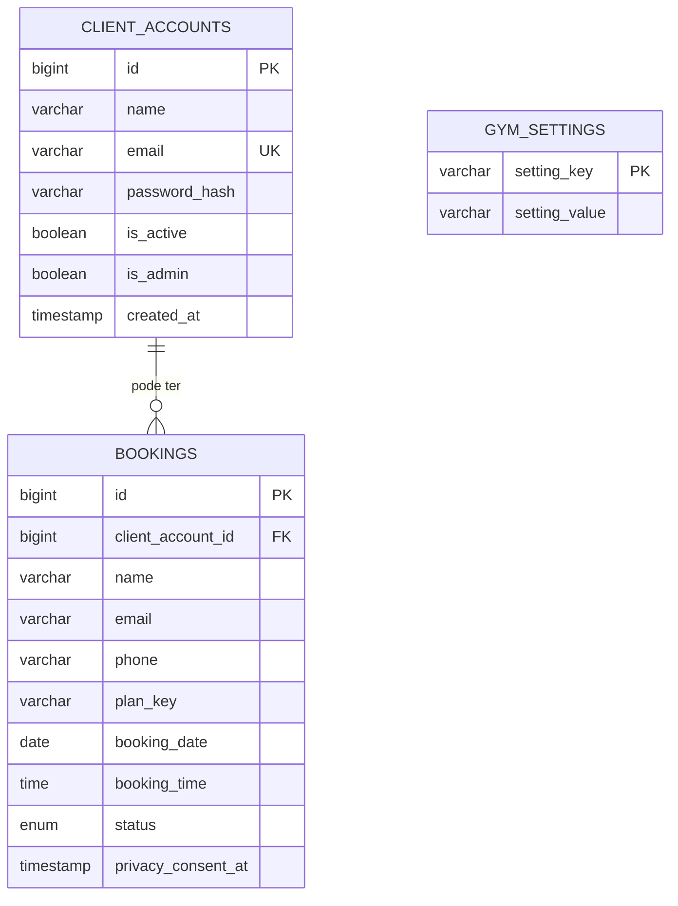

# PowerLift Gym — documentação do projeto

## Objetivo

Desenvolver um website para apresentar o PowerLift Gym e apoiar o processo de marcação, gestão de clientes e administração do ginásio.

## Requisitos funcionais

1. Apresentar treinos, planos, horários e informação do ginásio.
2. Permitir pedir uma sessão, validando nome, email, telefone, plano, data, hora e leitura da política de privacidade.
3. Guardar pedidos na base de dados e enviar uma notificação por email quando o serviço de email estiver configurado.
4. Permitir autenticação de clientes e administradores com palavras-passe guardadas em hash.
5. Permitir ao administrador consultar marcações, atualizar o seu estado, criar e editar clientes, desativar contas e configurar contactos e preços.
6. Permitir a um cliente consultar e cancelar imediatamente as suas próprias marcações futuras.
7. Disponibilizar o site em Português, Inglês, Espanhol e Francês.
8. Apresentar páginas de contactos e privacidade.

## Requisitos não funcionais

- Utilizar PHP e MySQL/MariaDB com `utf8mb4`.
- Validar os dados no servidor e usar consultas preparadas.
- Proteger formulários autenticados com tokens CSRF e codificar valores antes de os apresentar em HTML.
- Separar a configuração da base de dados dos ficheiros públicos.
- Usar HTTPS, credenciais fortes e uma conta MySQL com permissões limitadas antes de publicar o site.

## Casos de utilização

### Visitante

- Consulta a informação e os planos.
- Pede uma marcação e aceita a política de privacidade.
- Consulta contactos e muda o idioma.

### Cliente

- Inicia sessão.
- Consulta as marcações associadas à sua conta.
- Cancela uma marcação futura; pedidos passados não podem ser cancelados.

### Administrador

- Inicia sessão com uma conta de administrador.
- Consulta e confirma, cancela ou deixa pendentes os pedidos de marcação.
- Cria contas de clientes, atualiza os seus dados e desativa contas.
- Configura email público, telefone, morada e preços.

## Modelo de dados

Uma marcação pública pode não estar associada a uma conta. Quando o email da marcação corresponde a uma conta ativa, a marcação fica associada a essa conta e aparece na área de cliente.

## Instalação local

1. Iniciar Apache e MySQL no XAMPP.
2. Importar `auth-schema.sql` numa instalação nova. Para uma base de dados que já usa o esquema anterior, importar `pap-upgrade.sql`.
3. Criar `C:\xampp\pap-private-data\auth-config.php` a partir de `auth-config.example.php` e configurar a ligação MySQL.
4. Executar `create-admin.ps1` para criar a conta administrativa e `create-client.ps1` para criar contas de clientes.
5. Iniciar sessão em `login.php`. O administrador é encaminhado para `admin.php`; os clientes para `area-cliente.php`.
6. Configurar contactos e preços em `admin-config.php`.
7. Configurar SMTP no XAMPP para receber notificações por email. As marcações continuam guardadas na base de dados se o email não for enviado.

Os pedidos que existiam em `C:\xampp\pap-private-data\horarios.jsonl` ficam arquivados e não são importados automaticamente.

## Plano de testes manuais

| Teste | Resultado esperado |
|---|---|
| Enviar uma marcação válida com aceitação da política | A marcação é guardada e fica pendente; o email é enviado se o SMTP estiver configurado. |
| Enviar uma marcação sem aceitar a política | O pedido é recusado pela validação do servidor. |
| Iniciar sessão com uma conta de cliente | Abre a área de cliente, sem acesso ao painel administrativo. |
| Iniciar sessão com uma conta de administrador | Abre o painel administrativo. |
| Alterar o estado de uma marcação como administrador | O novo estado aparece na lista e no painel. |
| Tentar atualizar uma conta de administrador pela gestão de clientes | A conta administrativa não é alterada por esse formulário. |
| Cancelar uma marcação futura como cliente | A marcação passa imediatamente a cancelada e deixa de poder ser cancelada novamente. |
| Tentar cancelar uma marcação de outro cliente ou passada | A operação é recusada. |
| Alterar contactos e preços no painel | A página de contactos e os planos apresentam os novos valores. |
| Mudar o idioma | O idioma selecionado é mantido entre páginas. |

## Informação a completar antes de publicar

- Introduzir telefone, morada e preços verdadeiros no painel.
- Rever a política de privacidade com a identificação legal do responsável pelo tratamento e os prazos aplicáveis.
- Configurar SMTP e testar a entrega real de mensagens.
- Ativar HTTPS e substituir as credenciais de desenvolvimento do MySQL.
